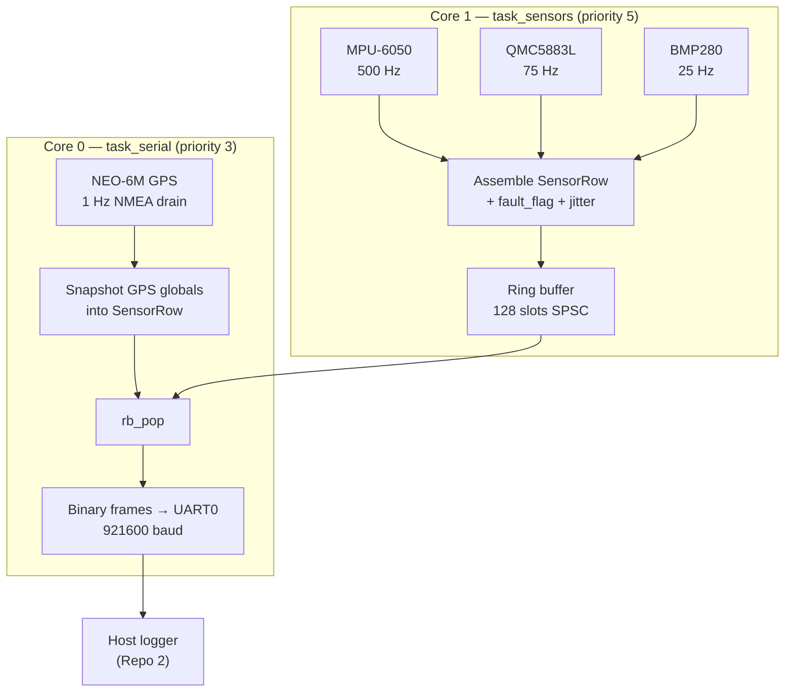
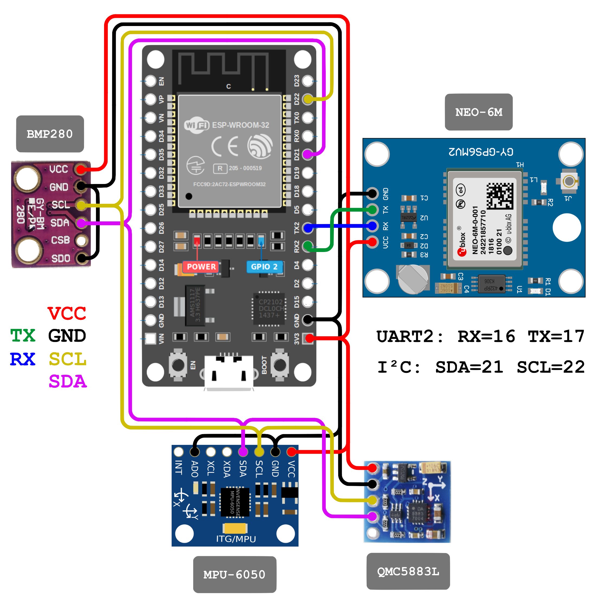
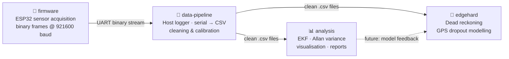

# Firmware | Multi-Sensor Navigation System

[](https://platformio.org)
[](https://arduino.cc)
[](https://www.espressif.com/en/products/socs/esp32)
[](LICENSE)
[](#multi-repo-structure)

> **Repo 1 of 4** · 500 Hz deterministic multi-sensor data acquisition firmware for real-time navigation systems.
> 
> Streams fused IMU · magnetometer · barometer · GPS telemetry as checksummed binary frames over UART at 921600 baud.
>
> ⚠️ *This repository was named `navigation-system-firmware` before moving under the `multi-sensor-navigation-system` organization from [@ShivtejG236](https://github.com/ShivtejG236).*

---

## What this is

Bare-metal firmware for **ESP32-WROOM-32 (devkit)** that acquires IMU, magnetometer, barometer & GPS data, assembles deterministic sensor frames and streams them over UART for downstream processing (repos 2–4).

The firmware runs two pinned FreeRTOS tasks:

| Task | Core | Priority | Responsibility |
|---|---|---|---|
| `task_sensors` | 1 | 5 | IMU/mag/baro polling, ring-buffer producer |
| `task_serial` | 0 | 3 | GPS UART drain, host output, ring-buffer consumer |

The split exists by design: `task_sensors` busy-waits at 500 Hz on Core 1 so it never misses an IMU deadline. GPS UART draining lives on Core 0 — if it ran on Core 1, the Core 1 UART ISR would starve and drop NMEA bytes.

---

## System Architecture



**Model:** `task_sensors` = producer · `task_serial` = consumer

Data flow is single-producer (Core 1) → single-consumer (Core 0) via a lock-free ring buffer.

---

## Hardware Setup


<table>
  <tr>
    <!-- Left column for data -->
    <td>
      <table>
        <tr><th>Component</th><th>Interface</th><th>Address</th></tr>
        <tr><td>MPU-6050 (IMU)</td><td>I²C</td><td>0x68</td></tr>
        <tr><td>QMC5883L (magnetometer)</td><td>I²C</td><td>0x0D</td></tr>
        <tr><td>BMP280 (barometer)</td><td>I²C</td><td>0x76</td></tr>
        <tr><td>NEO-6M (GPS)</td><td>UART2</td><td>9600 baud</td></tr>
        <tr><td>Host (logging)</td><td>UART0</td><td>921600 baud</td></tr>
      </table>
    </td>
    <!-- Right column for image -->
    <td></td>
  </tr>
</table>

All three I²C devices share the same bus at 400 kHz fast-mode.

Pins are set per board. Supported boards and how to add one: [`docs/boards.md`](docs/boards.md).

---

## Sample Rates

| Sensor | Rate | Period |
|---|---|---|
| MPU-6050 | 500 Hz | 2 000 µs |
| QMC5883L | 75 Hz | 13 333 µs |
| BMP280 | 25 Hz | 40 000 µs |
| NEO-6M | 1 Hz | 1 000 000 µs |

Lower-rate sensors are polled sub-sampled within the 500 Hz IMU loop — no separate timers, no RTOS overhead.

---

## Wire Format

The default build sends **binary frames**: `COBS(type | body | crc16)` terminated by `0x00`. Each 500 Hz sample is at most 103 bytes (about 56 % of the 921600-baud link), carries a checksum and a sequence number, and the stream resynchronises on the next `0x00` after any corruption. The firmware identifies itself (board, version, git revision, protocol version) in a `HELLO` frame at boot and every 2 s after.

The full specification is in [`docs/wire-protocol.md`](docs/wire-protocol.md). The host logger in [Repo 2](https://github.com/multi-sensor-navigation-system/data-pipeline) decodes the frames back into the CSV columns below.

> The original CSV stream needed about 177 bytes per row, which is 96 % of the link at 500 Hz. It is kept as a debug build: `pio run -e esp32dev-csv`.

---

## Sample Fields & Fault Flags

Each sample carries these fields (the CSV debug build prints them as one header line on boot, then one row per IMU tick):


<details>
<summary><b>Field Groups</b></summary>
    Fields are grouped (only here) by sensor domain for clarity:
    <table>
        <tr>
            <th>Group</th>
            <th>Fields</th>
        </tr>
        <tr>
            <td>[timing]</td>
            <td>t_imu_us, t_read_start_us, t_proc_end_us, t_gps_us</td>
        </tr>
        <tr>
            <td>[imu]</td>
            <td>ax_g, ay_g, az_g, gx_dps, gy_dps, gz_dps</td>
        </tr>
        <tr>
            <td>[mag]</td>
            <td>mx_uT, my_uT, mz_uT</td>
        </tr>
        <tr>
            <td>[baro]</td>
            <td>pressure_hPa, bmp_temp_C</td>
        </tr>
        <tr>
            <td>[gps]</td>
            <td>lat_deg, lon_deg, alt_gps_m, hdop, satellites</td>
        </tr>
        <tr>
            <td>[system]</td>
            <td>fault_flag, jitter_us</td>
        </tr>
    </table>
</details>

<details>
    <summary><b>Field Reference</b></summary>
    <table>
        <tr>
            <th>Field</th>
            <th>Unit</th>
            <th>Notes</th>
        </tr>
        <tr>
            <td>t_imu_us</td>
            <td>µs</td>
            <td>esp_timer_get_time() at IMU read start - monotonic, 1µs resolution</td>
        </tr>
        <tr>
            <td>t_read_start_us</td>
            <td>µs</td>
            <td>Earliest read start timestamp in the row</td>
        </tr>
        <tr>
            <td>t_proc_end_us</td>
            <td>µs</td>
            <td>After all sensor reads complete — subtract from `t_read_start_us` for processing budget</td>
        </tr>
        <tr>
            <td>t_gps_us</td>
            <td>µs</td>
            <td>Timestamp of last parsed GPS sentence</td>
        </tr>
        <tr>
            <td>ax/ay/az</td>
            <td>g</td>
            <td>Accelerometer — converted from m/s²</td>
        </tr>
        <tr>
            <td>gx/gy/gz</td>
            <td>°/s</td>
            <td>Gyroscope — converted from rad/s</td>
        </tr>
        <tr>
            <td>mx/my/mz</td>
            <td>µT</td>
            <td>Magnetometer — QMC5883L at 8G range, 3000 LSB/Gauss</td>
        </tr>
        <tr>
            <td>pressure</td>
            <td>hPa</td>
            <td>BMP280 — sanity-checked to 800–1100 hPa</td>
        </tr>
        <tr>
            <td>bmp_temp</td>
            <td>°C</td>
            <td>BMP280 temperature</td>
        </tr>
        <tr>
            <td>lat/lon</td>
            <td>degrees</td>
            <td>8 decimal places (~1.1 mm resolution)</td>
        </tr>
        <tr>
            <td>alt_gps</td>
            <td>m (MSL)</td>
            <td>GPS altitude</td>
        </tr>
        <tr>
            <td>hdop</td>
            <td>—</td>
            <td>Horizontal dilution of precision</td>
        </tr>
        <tr>
            <td>satellites</td>
            <td>—</td>
            <td>Satellites in use</td>
        </tr>
        <tr>
            <td>fault_flag</td>
            <td>bitmask</td>
            <td>See below</td>
        </tr>
        <tr>
            <td>jitter_us</td>
            <td>µs</td>
            <td>How many µs the IMU tick overshot its absolute deadline; 0 = on time</td>
        </tr>
    </table>
</details>

<details>
    <summary><b>Fault Flag Bitmask</b></summary>
    <table>
        <tr>
            <td>bit 0</td>
            <td>FAULT_IMU</td>
            <td>MPU-6050 read failed; stale values carried forward</td>
        </tr>
        <tr>
            <td>bit 1</td>
            <td>FAULT_MAG</td>
            <td>QMC5883L returned all-zero (I²C fault)</td>
        </tr>
        <tr>
            <td>bit 2</td>
            <td>FAULT_BARO</td>
            <td>BMP280 out-of-range or NaN</td>
        </tr>
        <tr>
            <td>bit 3</td>
            <td>FAULT_GPS_HDOP</td>
            <td>HDOP > 2.5 or satellites < 4</td>
        </tr>
        <tr>
            <td>bit 4</td>
            <td>FAULT_GPS_NOFIX</td>
            <td>No valid GPS fix yet</td>
        </tr>
    </table>
</details>

Fault flags describe the **current sample only** — they are not latched system faults. A `0x00` row means all sensors reported cleanly.

---

## Stale-Value Policy

When a lower-rate sensor misses its sub-deadline within a 500 Hz tick, the **last known-good value is carried forward** into that row's fields. The corresponding fault-flag bit is set so downstream consumers can distinguish fresh from stale. This guarantees consumers always see a valid reading rather than zeros.

---

## Ring Buffer

A **128-slot lock-free SPSC ring buffer** (`RING_SIZE` must be a power of 2) decouples the sensor task from the serial task. `rb_push` / `rb_pop` use `__sync_synchronize()` memory barriers to prevent store/load reordering across the two cores — no mutex, no FreeRTOS synchronisation primitive. If the ring fills (serial output can't keep up), the producer drops the row and increments `rb_drops`. The running count is reported once per second in the `STATUS` frame (as a `# rb_drops=12` line in the CSV debug build).

Designed for SPSC (single producer, single consumer); not safe for multi-writer scenarios.

---

## Repo-01 Structure

```
firmware/
├── src/
│   ├── main.cpp          # Sensor init, the two tasks
│   └── transport.cpp     # Host output: binary frames (default) or CSV
├── include/
│   ├── config.h          # Pin assignments, sample rates, fault flags, ring size
│   ├── sensor_row.h      # SensorRow struct + lock-free ring buffer
│   ├── transport.h       # Host transport interface
│   ├── wire.h            # Wire protocol v1: framing, CRC, COBS
│   └── version.h         # Firmware version
├── boards/               # One manifest per supported board (pins, flash layout, status)
├── scripts/
│   ├── version.py        # Stamps the build with the git revision
│   ├── board.py          # Applies the board manifest to the build
│   └── boards.py         # Manifest loading and validation
├── tools/
│   ├── host/             # Host-side protocol tests + golden stream generator
│   ├── check_boards.py   # CI check: manifests ↔ PlatformIO environments
│   └── release.py        # Merges release images and writes manifest.json
├── platformio.ini        # PlatformIO build config
├── sdkconfig.defaults    # ESP-IDF SDK overrides (task WDT tuning)
└── docs/
    ├── wire-protocol.md  # Wire protocol specification
    ├── boards.md         # Supported boards, adding a board
    └── setup.png         # Schematic diagram
```

---

## Dependencies

Managed by PlatformIO — no manual installation needed.

| Library | Version | Purpose |
|---|---|---|
| `adafruit/Adafruit MPU6050` | ^2.2.6 | IMU driver |
| `mprograms/QMC5883LCompass` | ^1.0.2 | Magnetometer driver |
| `adafruit/Adafruit BMP280 Library` | ^2.6.8 | Barometer driver |
| `mikalhart/TinyGPSPlus` | ^1.0.3 | NMEA sentence parser |
| `adafruit/Adafruit Unified Sensor` | ^1.1.14 | Sensor abstraction layer |

---

## Build & Flash

```bash
# Build and flash the default (binary) firmware
pio run -e esp32dev --target upload
```

Replace `esp32dev` with another board id from [`docs/boards.md`](docs/boards.md) to build for it. Released images can be flashed without PlatformIO: `nav flash` from [Repo 2](https://github.com/multi-sensor-navigation-system/data-pipeline) detects the board and downloads the right one.

The binary stream is not readable in a serial monitor; log it with the host logger from [Repo 2](https://github.com/multi-sensor-navigation-system/data-pipeline), which prints the firmware's messages and writes the CSV.

To watch the stream by eye, flash the CSV debug build:

```bash
pio run -e esp32dev-csv --target upload && pio device monitor --baud 921600
```

```
# MPU-6050 OK
# QMC5883L OK
# BMP280 OK
# GPS UART started — waiting for fix (HDOP reported in data)
# hello board=esp32dev;fw=0.2.0;git=abc1234;imu_hz=500;...
t_imu_us,t_read_start_us,...
```

If a sensor is absent, firmware continues logging available sensors and reports a `WARN` message. `fault_flag` will reflect which sensor is missing on every row.

---

## Implementation Notes

**Why the WDT is unregistered for idle tasks:** `task_sensors` busy-waits at 500 Hz on Core 1, which starves the idle task. Without `esp_task_wdt_delete()` on both idle tasks (and on `loopTask`), the TWDT fires every ~5 s and hard-resets the chip. `sdkconfig.defaults` disables the idle-task TWDT at the SDK level; the runtime calls are an explicit belt-and-suspenders.

**Why GPS UART draining is on Core 0:** The UART receive ISR runs on whichever core processes the interrupt. If `task_sensors` owned the UART drain, the 500 Hz busy-wait would starve the ISR on Core 1 and drop bytes in NMEA sentences. Core 0 yields via `vTaskDelay(1)` each iteration, giving the ISR clean execution windows.

**Double-write tearing on GPS globals:** `lat` and `lon` are `volatile double` (64-bit) written on Core 0 and read on Core 1. Xtensa LX6 does not guarantee atomic 64-bit stores; a torn read is possible. This is acceptable for logging — the corruption is bounded to one sample and corrected on the next GPS sentence.

---

## Project Ecosystem



| Repo | Role | Status |
|---|---|---|
| **`firmware`** ← *(this repo, formerly navigation-system-firmware)* | ESP32 firmware — sensor acquisition & binary streaming | ✅ Active |
| [`data-pipeline`](https://github.com/multi-sensor-navigation-system/data-pipeline) | Host-side logger & calibration — reads serial, writes timestamped CSV | 	✅ Active |
| [`analysis`](#) | Offline processing — EKF, Allan variance, map visualisation, reports | 🚧 In progress |
| [`edgehard`](#) | Dead reckoning — GPS dropout modelling, edge inference | 🔜 Planned |

## Why this exists

This project explores how sensor systems behave under high-frequency, tightly timed acquisition.

Instead of abstract simulation, it focuses on:
- capturing raw sensor imperfections (noise, drift, jitter)
- understanding timing effects in multi-rate systems
- building a reliable data foundation for downstream estimation (EKF, dead reckoning)

The goal is to bridge the gap between clean theoretical models and messy real-world sensor data.
